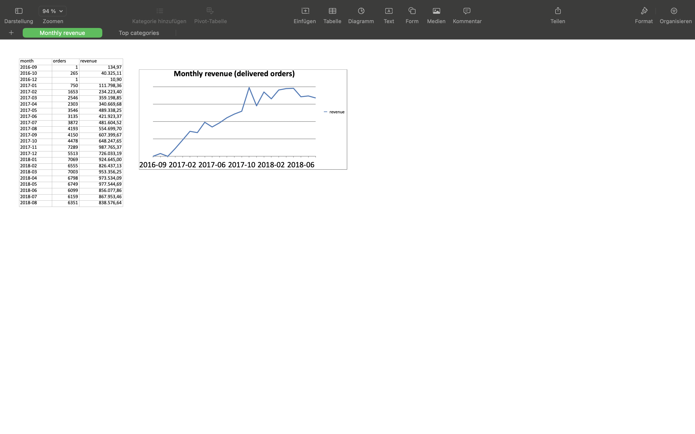

# Sales Analytics Pipeline

A Python project that loads e-commerce order data (Olist Brazilian E-Commerce
dataset from Kaggle), checks its quality, cleans it and calculates delivery
metrics. Built with pandas.

## Current status

- `src/load.py`: reads CSV files and reports basic data quality
  (rows, duplicates, missing values).
- `src/clean.py`: converts date columns, calculates delivery time in days and
  flags late deliveries.

## How to run

```bash
python -m venv .venv
source .venv/bin/activate
pip install -r requirements.txt
python src/clean.py
```

The CSV files are not stored in the repository. Download the dataset from
Kaggle and put the files into the `data/` folder.

## Data quality notes

- 2,965 of 99,441 orders have no delivery date. Most of them are orders that
  are still in transit (`shipped`) or will never arrive (`canceled`,
  `unavailable`). These gaps are expected, so the missing values were kept.
- 8 orders have the status `delivered` but no delivery date. They are excluded
  from the delivery time calculation.
- 6 `canceled` orders have a delivery date. They are kept in the data, and the
  reason is unknown.
- 288 delivered orders (about 0.3%) took more than 60 days. Several of the
  slowest ones share the same delivery date, so the date may have been entered
  in bulk. These orders are kept in the data.
- Delivery time and the share of late deliveries are calculated only for
  orders with a delivery date. Orders without one are not counted as "on time".
- Excluding orders over 60 days changes the mean delivery time only slightly
  (12.1 to 11.9 days), the median stays at 10 days.
- 610 products have no category. They were labeled `unknown`. These products
  account for about 1.3% of revenue from delivered orders, so the category
  analysis is not much affected.
- Revenue is the sum of item prices of delivered orders. The data for 2016 is incomplete, and the dataset ends in August 2018.
- Two product categories (`pc_gamer`, `portateis_cozinha_e_preparadores_de_alimentos`)
  have no English translation in the Olist translation table. They are kept
  with their original Portuguese names (`LEFT JOIN` + `COALESCE`).

## Report preview



## Quick start with the sample data

The repository contains a small sample (200 orders) in `data/sample/`, so the pipeline can be run without downloading the full dataset:

    python main.py --data-dir data/sample --db data/sample.db --output output/sample_report.xlsx

To run it on the full dataset, download it from Kaggle, put the CSV files into
`data/` and run `python main.py`.

## Data source

Olist Brazilian E-Commerce Public Dataset (Kaggle). The files in `data/sample/`
are a random subset of it (created with `src/make_sample.py`). Please check the
license on the Kaggle page before reusing the data.
